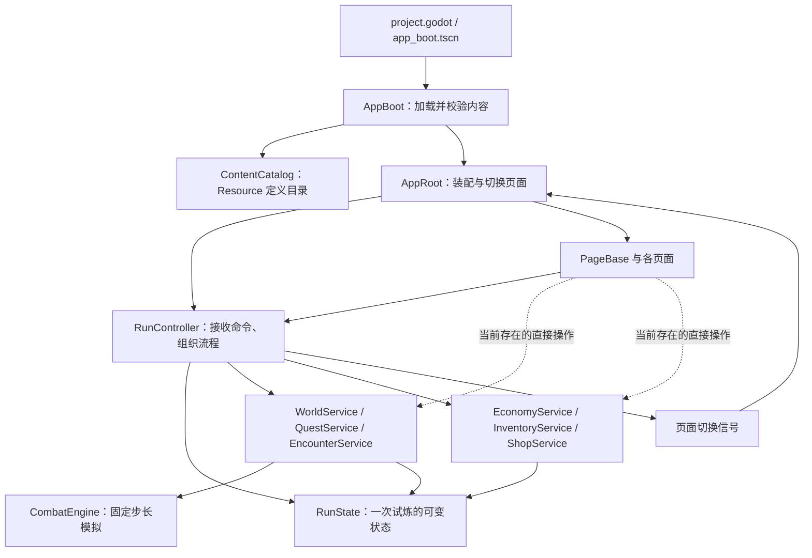

# 项目架构梳理与评估

> 历史评估边界（2026-10-15）：本文保留2026-10-08的代码行号、行数和测试结果，不是实时架构状态。物品内容已转入Excel生成包，新版节点页面与服务也已加入；当前复用入口及仍需适配的问题见[工程复用与文档核查](../engineering/engineering-status.md)。不要按本页旧行号直接修改代码。

评估日期：2026-10-08。范围：当前工作区的 Godot 工程、设计方案、主要业务模块、界面与测试入口。工作区已有文档迁移及其他未提交修改，本次按当前文件评估，不代表某个固定提交。

## 结论

**作为第一阶段可玩原型，整体架构合理，可以继续迭代；在继续增加世界、物品交互和界面前，应先收紧状态修改入口并拆分两个复杂页面。无需推倒重写。**

目录分层基本落实了技术方案。真正需要处理的是部分调用越过模块接口、预览与提交规则重复、运行状态与界面状态混杂。文件行数只是定位线索，不单独构成重构理由。

## 当前结构与运行流程

```text
game/
├─ 根目录设计规范                 长期玩法、规则、物品与交互规范
├─ docs/                         阶段设计、工作流、历史方案、验证和计划
├─ _验证/                        数值实验、截图与复演证据
├─ ui/                           原始视觉素材与样稿
├─ dist/                         试玩交付产物
└─ godot_prototype/               可运行的 Godot 工程
   ├─ project.godot              项目配置与启动场景
   ├─ scenes/app/app_boot.tscn   当前唯一的 .tscn 启动场景
   ├─ scripts/data/             自定义 Resource 定义类型
   ├─ data/                     实际 .tres 内容与内容版本清单
   ├─ scripts/core/             内容加载、试炼状态、流程控制、随机与日志
   ├─ scripts/combat/           战斗状态、固定步长规则、事件与结果
   ├─ scripts/economy/          物品操作、交易、价格、商店
   ├─ scripts/world/            世界导航、任务、遭遇与结算
   ├─ scripts/ui/               页面装配、通用面板、皮肤、地图展示
   ├─ scripts/dev/              开发模式与固定验证输入
   ├─ assets/                   工程使用的美术资源
   ├─ tests/                    规则、流程、界面验证及证据生成
   └─ tools/                    内容生成、素材加工与打包
```

`scripts/data` 是定义类型，`data` 是定义实例，两者并不重复。`core` 内大多是普通对象，并未堆积大量 Autoload 单例。



图中省略了内容、随机、日志的公共依赖。战斗页还负责帧时间累积和调用 `CombatEngine.step()`；数值运算由引擎完成，遭遇模块将结果提交回试炼状态。

## 值得保留的设计

1. **定义、试炼实例和战斗临时状态分开。** Resource 表达内容，ItemInstance 表达物品实例，BattleItemState 表达本场冷却与成长。避免共享定义被某一局污染。
2. **战斗规则脱离画面。** CombatEngine 继承 RefCounted，不依赖页面、动画或物理节点；能逐步推进或直接跑完。现阶段 628 行集中维护严格结算顺序有价值，不宜只为减小文件而拆散执行顺序。
3. **随机流按作用域隔离。** RandomService 区分商店、掉落与战斗等作用域，为复演与定位问题提供基础；其承诺是同版本内复现。
4. **关键结果有重复提交防护。** EncounterService 按 battle_id 检查 submitted_battles，降低重复结算收益风险。
5. **已有可复用界面模块。** PanelInventory 通过清单和操作信号承担展示，皮肤模块集中提供素材与矩形，方向正确。
6. **测试覆盖不只停留在战斗。** 当前包含内容检查、经济、世界路线和界面冒烟测试，为渐进调整提供基础。

## 优先处理的问题

### 1. 只读预览修改真实状态，且规则有两份实现

证据：`scripts/core/run_controller.gd:491` 的 `preview_auto_synth()` 标注只读，但第 494 行调用 `state.new_instance()`。后者在 `scripts/core/run_state.gd` 中既递增 `_seq`，又向 `_instances` 登记实例；预览创建的变量随后未被使用。

影响：调用一次预览就改变后续实例编号并增加无用途实例。当前未在界面代码中找到该预览函数的调用，不能将其描述为已经影响日常游玩的故障，但在接入前应修复。

预览还重新实现了合成链，而真实的 `InventoryService.auto_synthesize_into()` 有可装备性限制，预览没有对应限制。两份规则存在偏离。

建议：InventoryService 内部统一计算操作计划，预览只返回最终品质、容量与失败原因；正式操作校验通过后再创建实例和提交。同一份规则同时支持预览与执行，避免新增一套预测算法。

### 2. 页面绕过流程接口，业务修改散落到展示代码

证据：`scripts/ui/pages/page_battle.gd:727` 直接调用 `ctrl.inventory.pickup(ctrl.state, it)`，随后直接 `es.pending_drops.erase(it)`。领取一个掉落所需的“入包＋从待领取列表移除”由页面组织。

`scripts/ui/pages/page_minimap.gd:1169` 的 `_validate_drop()` 重新实现装备资格和容量规则，第 1185 行调用 InventoryService 的内部辅助方法 `_insert_at()`。

影响：新增领取入口需要再次正确组合操作；调整背包规则需要同步改业务与界面；内部实现难以独立变更。读取状态用于显示本身不是主要问题，写入和复制规则才是。

建议：增加一个可独立测试的单件掉落领取命令，统一检查待领取关系并完成领取；把拖拽预览放到物品模块接口内。页面提交意图并显示结果。

### 3. 两个页面承担过多独立变化的职责

`page_minimap.gd` 共 1490 行，同时构造房间、墙体、角色、交互区域、移动输入、HUD、背包、拖拽、菜单、提示和节点动作。

`page_battle.gd` 共 1054 行，同时负责战斗布局、帧推进、暂停倍速、日志格式、统计抽屉、结算阶段和掉落领取。

影响：一次物品交互调整会触碰探索展示与战斗展示；世界移动、HUD 和物品操作难以分别验证。问题是职责的变化原因不同，而不是超过某个行数阈值。

建议的自然拆分：

- 小地图页面保留装配，将房间与角色移动、探索 HUD、物品拖拽交互分别收拢成模块。
- 战斗页面保留装配，将战斗播放控制、双方状态展示、日志统计、战后掉落展示分别收拢。
- 优先复用实际重复的物品格、说明与交互能力，不强行把探索 HUD 塞进视觉用途不同的 PanelInventory。

当前只有一个 .tscn，大量节点用代码构建。这是可行的原型策略，但会增加编辑器直接调布局和复用场景的成本。适合将稳定、反复调整的视觉模块逐步做成独立场景，不必一次改写所有页面。

### 4. RunController 同时管理游戏流程、导航、HUD 与测试配置

证据：`scripts/core/run_controller.gd` 共 678 行；既创建并装配业务对象，又管理页面名称、商店/构筑返回位置、Tab/B 显示状态、开发模式、固定库存和耗时分桶。

影响：界面展示调整会触及试炼流程对象；测试数据安装和正式流程共用较大的接口。控制器适合作为应用编排入口，但不应继续吸收每个页面的新状态。

建议：先迁出 HUD 显示状态与页面返回管理，再将开发固定输入装配放到独立入口。继续保留一个清晰的试炼编排入口，不引入大量只转发一次调用的小模块。

另外，RunState 的 `running/failed/stage_complete/surrendered` 表示试炼生命周期，不能单独表达战斗中还是整备中。若以后出现更多命令入口，应明确谁检查“当前阶段允许此操作”，避免只依赖按钮是否可见。当前不据此断言普通操作已经可在战斗中执行。

### 5. 部分失败操作仍提前登记中间实例

证据：`InventoryService.synthesize()` 第 117 行、`auto_synthesize_into()` 第 243 行先调用 `state.new_instance()`，随后才执行最终容量检查。容量检查失败时，没有撤销实例登记和序号变化。

影响：失败时已持有数组可以保持不变，但整个 RunState 并非完全未变。重复失败可能遗留无用途登记实例，给实例查询、统计与未来持久化增加负担。不是已经证明存在可重复领取或物品复制漏洞。

建议：与第 1 项一起处理，将计划计算与真实提交分开；为失败操作补充完整状态不变的断言，包含实例集合与序号行为，而不只比较金币、背包占用。

## 后续扩展时再处理

- **内容来源约定：** `tools/build_content.gd` 写出已提交的 `.tres`。应在实际内容编辑流程中明确生成器或 Resource 哪个是修改入口，避免编辑器调整被重新生成覆盖；当前没有执行重生成，也未验证两者有无漂移。
- **内容驱动的范围：** 战斗效果使用公共类型，但连锁被动仍明确识别 `ever_stronger`、`flame_aegis`、`rejuvenating_aegis`。对现有三个技能合理；数量明显增长后，再抽取触发处理模块，暂不建设任意技能脚本语言。
- **开发模式隔离：** DevTools 使用静态状态，`dev_enabled` 默认 true。原型便于验证；正式交付前需明确发布配置，避免多个控制器共享测试开关带来干扰。
- **持久化：** 技术方案明确跨会话存档在原型闭环之后。当前不具备完整存档模块不算本阶段架构缺陷；真正接入时再定义保存格式、版本与恢复契约。

## 建议实施顺序

| 顺序 | 调整 | 验收重点 |
| --- | --- | --- |
| 1 | 修复预览副作用，合并预览与提交的规则计算 | 预览不改任何实例；预览与执行结果一致；失败不残留中间实例 |
| 2 | 收拢单件掉落领取和拖拽校验 | 页面不再写 pending_drops，不调用物品模块内部辅助方法 |
| 3 | 拆分小地图 HUD、房间移动及物品交互 | 原有键鼠交互、布局与世界状态保持正确 |
| 4 | 拆分战斗展示与播放控制 | 固定步长、暂停、结算和掉落领取行为一致 |
| 5 | 迁出控制器的界面状态与开发装配 | 导航返回正确，测试配置不串会话 |

每一步保持玩法与数值不变，利用现有回归及针对性行为断言验证，不做一次性目录大搬迁。不建议现在引入 ECS、全局事件总线、通用仓储层或微服务。

## 验证范围与限制

实际运行：

```powershell
& 'D:/Godot/Godot_v4.7.2-stable_win64_console.exe' --headless --path godot_prototype --script res://tests/headless_main.gd
```

结果：战斗 73、内容 43、经济 151、世界流程 249、界面冒烟 374，合计 **890 项通过，0 项失败**，退出码 0。

本次为架构静态评估与现有回归验证，没有运行真实渲染截图或人工游玩，没有修改游戏代码。测试通过说明已有断言覆盖的行为稳定，不能证明预览纯度、失败事务完整性以及所有鼠标交互都已得到验证。
