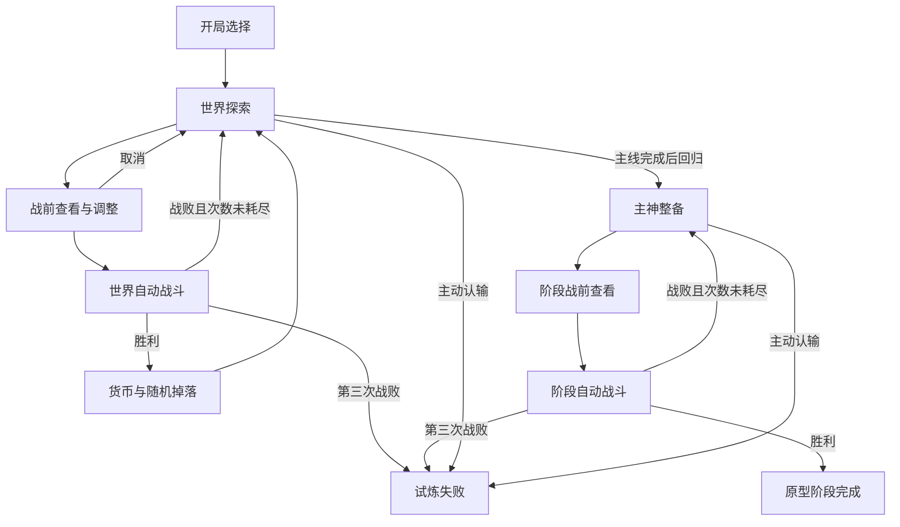

# 游戏可玩原型技术方案
> 适用范围（2026-10-15）：这是旧原型建项方案；定义/实例分层、无界面战斗和测试思路可复用，自由移动、金币节点收费及原目录规划不是新版要求。物品生成来源现为Excel，当前架构与复用边界见[工程复用清单](../../engineering/engineering-status.md)。下文引擎下载信息是成文时记录，不是当前官方版本声明。
> 历史方案状态（2026-10-08）：Godot 工程已建立，原文“尚未创建或验证工程”等句子保留为成文时记录。当前实现与未完成项见 [R0.8 系统组件接入](../../validation/R0.8_系统组件接入.md)及[已知问题清单](../../validation/游戏原型已知问题清单.md)。

> 更新日期：2026-10-07。版本：v0.1。
> 用户已确认：Godot 引擎、从空项目开始、保留小地图自由移动、使用占位素材。
> 本文是后续创建项目与实现的技术依据，当前交付是方案文档，尚未创建或验证 Godot 工程。
> 玩法依据：[游戏核心规则定稿.md](../../design/游戏核心规则定稿.md)、[游戏最小战斗与经济方案.md](游戏最小战斗与经济方案.md)、[游戏单局推演.md](游戏单局推演.md)。已定玩法不因技术实现擅自变更。实现默认与新增内容参数分别标记。
> 第一阶段体验需求与验收补充见 [游戏一阶段原型需求.md](游戏一阶段原型需求.md)，已获用户整体确认。节点内容搭配、守路连接、首版支线目标追认、战前战后反馈及信息展示范围按该文档执行；测试版本暂不做首次操作提示、节点剩余机会摘要或远程库存查看。

## 1. 原型目标与交付边界

做一个能从开局选择玩到第一阶段挑战结束的 Windows 原型：

选择职业、血统 → 免费进入武道世界 → 小地图移动、NPC交互与搜刮 → 付费探索新节点 → 战前查看与调整 → 自动战斗与掉落 → 完成主线 → 继续探索或回归 → 主神整备 → 挑战固定阶段对手。

第一阶段胜利显示“原型阶段完成”，统计本阶段收益、生命、战败和用时，不将其显示为正式三阶段通关。第三次战败或主动认输结束本次试炼。保留以后接入第二、第三阶段的接口。

首版包括12件主动物品、3个独立被动技能、2种职业、2种血统、四档品质数据、背包与合成、随机商店和掉落。黄金、钻石可通过合成或开发测试获得；第一阶段商店仍按85%青铜、15%白银供给。

内容工作优先固定18节点的样本连接与主线位置，用少量复用小地图场景配置不同内容。主线位置对开发者固定，不等于玩家开局已知。地图随机生成、三个完整世界、美术制作、音效精修、局外解锁、联网、Steam接入和玩家跨会话存档留到原型闭环之后。

开发交付：可编辑Godot项目、Windows可执行试玩包、配置数据、无画面的规则验证入口、试玩日志和已知问题清单。

## 2. 环境与技术选择

| 项目 | 采用方案 |
| --- | --- |
| 引擎基线 | Godot 4.7.2 标准版，Windows x86_64 |
| 编程语言 | 带类型标注的GDScript |
| 渲染 | Compatibility |
| 游戏形式 | 2D俯视小地图；自动战斗在独立界面表现 |
| UI | Godot Control节点、Container布局、统一Theme |
| 基准画面 | 1280×720，可调整窗口尺寸；UI按可用空间伸缩 |
| 内容定义 | 自定义Resource与文本.tres |
| 运行状态 | 独立RefCounted数据对象，场景负责展示 |
| 日志与测试输入 | JSON，使用稳定字符串ID |
| 首轮输入 | 键鼠；WASD/方向键移动、E交互、Tab大地图、B构筑、Esc关闭界面/暂停 |

截至本次核对，官方Windows下载页提供Godot 4.7.2标准版与.NET版；本项目选择标准版和GDScript，不需要另装.NET SDK。编辑器解压即可运行；导出Windows试玩包时使用相同版本的导出模板。[官方Windows下载](https://godotengine.org/download/windows/)

Compatibility适用于本次无需高级渲染功能的2D原型；这是项目选择，后续有真实渲染需求再评估。[官方渲染器说明](https://docs.godotengine.org/en/stable/tutorials/rendering/renderers.html)

实现期间固定引擎版本，日志记录完整版本号；数值配置修改时增加content_version。当前环境未从常用命令路径定位到Godot，不能据此判断电脑其他位置是否已有编辑器。

## 3. 项目位置与目录

计划在当前工作区下新建 godot_prototype/，将现有设计文档与验证资料保留在项目外，避免导入文档和中间产物作为游戏资源。以下是规划目录，当前尚未生成：

```text
game/
├─ 游戏可玩原型技术方案.md
├─ 游戏最小战斗与经济方案.md
├─ _验证/                        # 已有数值计算资料
└─ godot_prototype/
   ├─ project.godot
   ├─ scenes/
   │  ├─ app/                   # 启动、开局选择、结果
   │  ├─ world/                 # 大地图、小地图、角色、交互实体
   │  ├─ battle/                # 战前、战斗、战后反馈
   │  └─ ui/                    # 构筑、商店、掉落、任务、主神整备
   ├─ scripts/
   │  ├─ core/                  # 试炼状态、配置加载、随机服务
   │  ├─ combat/                # 固定步长引擎、效果、事件、结果
   │  ├─ economy/               # 交易、背包、合成、奖励
   │  ├─ world/                 # 节点、NPC、遭遇、任务和信息
   │  └─ ui/                    # 展示与用户命令
   ├─ data/
   │  ├─ items/
   │  ├─ skills/
   │  ├─ traits/
   │  ├─ enemies/
   │  ├─ shops/
   │  └─ worlds/
   ├─ assets/                   # 占位图形、字体与Theme
   └─ tests/                    # 数据检查、战斗基准、流程验证
```

Godot生成的.godot缓存不进入版本管理；编辑器生成的有效资源UID文件随项目保留。首次项目实现时再初始化版本管理与忽略规则，当前不替用户创建远程仓库。

## 4. 模块分工

| 模块 | 职责 | 关键边界 |
| --- | --- | --- |
| App/RunController | 页面切换、状态迁移、开局与结束 | 只保留一个当前试炼 |
| ContentCatalog | 加载定义、查ID、数据校验 | 不保存玩家生命、库存或战斗状态 |
| RunState | 玩家物资、货币、生命、战败、世界状态 | 场景关闭不能重置它 |
| WorldService | 节点进入、费用、状态保留、情报 | 不直接执行伤害 |
| InventoryService | 装备、卸下、拾取、丢弃、合成 | 每次操作先验证容量与持有关系 |
| EconomyService | 买卖、刷新、账本 | 钱与物品一次性提交 |
| QuestService | 主线、支线、自动与NPC领奖 | 每项奖励最多领取一次 |
| EncounterService | 战前输入、战后奖励与失败归位 | 遭遇从世界状态读写，不以节点实例存活为依据 |
| CombatEngine | CD、效果、状态、事件、胜负 | 不引用UI、物理节点或动画 |
| CombatPresenter | 冷却条、生命、效果提示、反馈 | 读取引擎事件，不反向决定数值 |
| RandomService | 独立随机流、种子、调用记录 | 查看界面不消耗随机数 |
| SessionRecorder | 操作、经济、战斗、耗时、结束摘要 | 日志用于验证，不增加游戏收益 |

只将RunController、ContentCatalog、RandomService及记录入口作为必要全局入口。业务服务是普通对象，避免为每种效果新增全局单例。UI提交命令，成功后监听状态变化刷新；禁止按钮直接修改金币、生命或物品数组。

## 5. 定义与实例分开

Resource用于可编辑定义，Godot支持自定义Resource与.tres序列化。[官方Resource说明](https://docs.godotengine.org/en/stable/tutorials/scripting/resources.html)

| 数据 | 主要字段 |
| --- | --- |
| ItemDef | definition_id、名称、类别、标签、占格、CD毫秒、四档效果数组、自身被动 |
| EffectDef | 效果类型、目标规则、取值字段、持续范围、事件类型 |
| SkillDef | definition_id、四档数值、订阅事件、效果列表 |
| TraitDef | 职业/血统ID、被动效果、基础属性修正 |
| EnemyDef | 模板ID、生命、装备定义与品质、额外强化、技能 |
| ShopDef | shop_id、候选池、类别/品质权重、商品数、刷新费 |
| WorldDef | 节点与连接、入口、NPC配置、任务、守路条件 |
| ItemInstance | instance_id、definition_id、品质、试炼成长、当前位置 |
| SkillState | 技能ID、品质、试炼成长 |
| PlayerState | 当前/最大生命、职业、血统、货币、战斗栏、背包、已学技能 |
| NodeState | 已进入、收费已结算、敌人/容器/事件状态、商店ID、掉落物 |
| ShopState | 商品实例、购买空位、锁定、刷新序号 |
| EncounterState | 未击败/已击败、奖励ID、结果结算标记 |
| QuestState | 未接/进行/完成/已领奖、计数、奖励类型 |
| BattleItemState | 本场冷却、加减速/冻结剩余时间、本场数值成长、释放次数 |
| BattleResult | 唯一ID、胜负、双方生命、时间、统计、事件摘要 |

定义只读；同名装备的实例必须有不同ID。战斗运行数据另建，不写回共享Resource，避免一件装备成长影响所有同名装备。

品质用固定枚举BRONZE/SILVER/GOLD/DIAMOND；效果数值按四档数组取值，不用品质乘数推导。货币为整数，价格表用偶数；伤害、治疗、护盾保留小数。种子和随机状态在JSON记录中以字符串存储，避免大整数被浮点解析改变。

## 6. 试炼与页面流程



世界商店、构筑、任务与大地图作为探索中的模态界面，不重新创建试炼。打开模态界面暂停角色移动；战斗中不可整理、交易、使用战斗外恢复品或中途退出到大地图。Esc战斗时只打开暂停菜单，暂停停止战斗时钟。

完整项目以后由阶段胜利进入下一世界，当前原型只输出阶段完成结果。主线未完成时回归按钮禁用并说明原因；认输是独立操作，不能伪装成正常回归。

## 7. 固定步长战斗实现

采用100毫秒一个战斗时间步，将此前验证约定落为首版实现默认。所有现有CD、充能和控制时长均可按该步长表示；冷却自然推进毫秒量为正常100、加速200、减速50。

渲染每帧积累经过时间，达到一个步长时调用step()，延迟帧可连续推进多个时间步，不跳过结算；画面只更新最新状态和待播放效果。无画面测试直接循环step()。暂停不积累时间，战斗倍速只作为开发调试功能。

每步固定执行：
1. 读取本步已有控制状态，推进自然冷却；冻结者不推进。递减控制时长。
2. 双方共同锁定本步就绪且本步未被冻结的释放。锁定时快照效果值并重置该物品CD。
3. 双方处理本次直接生命上限变化、护盾和治疗，记录计算治疗量与实际恢复量。
4. 处理攻击、已有异常状态的整数秒跳伤与沙尘暴。新施加异常不参与本步跳伤。
5. 双方全部伤害完成后检查死亡；同死判玩家失败，立即生成结果，不执行后续连锁。
6. 存活时施加本次异常与控制，分发使用物品、使用武器、施加灼烧、中毒、治疗等事件。
7. 独立事件各自触发充能、成长或护盾；被充能到就绪只标记，下一步才允许释放。
8. 输出本步状态与日志，清空已处理事件。

事件有event_id、时间步、来源实例、目标、计算量和实际量；同一事件不得重复处理。多个同帧武器使用事件分别给每件护身佩充能1秒。获得被动护盾不产生“使用护盾物品”；满血治疗仍产生治疗事件。

吸血的治疗发生在连锁阶段，死亡检查之后不能靠它复活；该治疗可触发回春护体。技能本身的被动触发不产生主动物品使用事件。本批事件关系有限，直接实现这些公共事件和效果类型，不引入可执行任意表达式的技能脚本语言。

同帧会受护盾抵挡的普通伤害可汇总处理，生命伤害用于统计时按原伤害比例分摊来源；中毒与沙尘暴分别记录。当前没有实际承伤触发技能，分摊不改变既有总伤害。生命上限变化沿用已有增减与战后清理规则。

战斗输入是双方快照、种子与配置版本；输出只把有效当前生命和结算结果提交回试炼。本场护盾、状态、伤害成长清除，明确试炼成长另行保存。失败返回入口或主神整备，对手从战前状态重建。

## 8. 随机与复现

使用独立RandomNumberGenerator对象：世界内容、每个商店、掉落、阶段模板、每场战斗各自一条随机流，避免移动或打开UI改变商品和掉落。记录主种子、作用域、生成序号与关键抽取结果。

Godot官方支持按seed复现同一随机序列，并通过state恢复状态；其底层算法是实现细节，不能承诺跨引擎版本一致。[官方随机数文档](https://docs.godotengine.org/en/stable/classes/class_randomnumbergenerator.html)

已有JavaScript验证使用的随机算法与Godot不同：不能直接要求相同整数种子下的控制目标、98/100结果与旧脚本一致。迁移验收分为：
- 无随机目标战斗：逐步/结果精确对照已有数值。
- 随机控制战斗：以显式目标ID序列回放做精确对照；正常随机模式检查目标合法性、同版本可复现与分布。
- 世界流程：固定库存和掉落序列作为独立开发测试模式；普通游玩保持真实随机，没有保底。

阶段对手在回归、进入整备时生成一次并保存，不因换装或重试改变。新的战斗尝试可使用独立战斗种子，但不会改变敌人配置。查看敌人、取消挑战、查看商店不消耗抽取随机数。

不使用直接执行文本的方式解析技能或任务数据；数据只指定已实现的效果与条件类型。

## 9. 小地图与节点状态

角色使用CharacterBody2D、俯视移动模式与move_and_slide()，地形使用StaticBody2D碰撞，交互点使用Area2D。该角色节点支持脚本控制移动，floating模式适合俯视运动。[官方角色节点文档](https://docs.godotengine.org/en/stable/classes/class_characterbody2d.html)

首版三种复用布局：
- 城镇：多个NPC服务点、人物挑战区、容器，空间宽敞。
- 道路/山口：可绕开的敌人、少量障碍、守路通路。
- 营地：可选战斗、容器、主线目标或强敌。

用颜色、名称、简单图形区分人物、敌人、容器和通路。玩家蓝色，敌人红色，商人绿色，情报NPC黄色；功能文字同时保留，不只靠颜色区分。

大地图使用现有18节点和双向连接；默认显示连接与未知节点编号，已发现后显示内容。01入口免费。首次进入其他节点先显示费用、验证余额，再一次性扣款、标记已付费并加载小地图；加载失败不得保留扣款。重访不收费、不增加计数，主线前后共用阶梯。

节点场景销毁前将位置与内容状态保存到NodeState，重建时按状态显示：
- 敌人已击败则不复活；失败遭遇可重试。
- 容器只生成一次结果，开启不重复抽取，未拾取实物留在节点。
- 已完成事件不重复奖励；技能放弃后消失，不能重访再学。
- NPC商店按shop_id找原库存。
- 正常重访可恢复离开位置；战败明确回当前节点入口。

所有可选敌人有实体和战前界面。敌人接触自动打开战前界面；取消后屏蔽该敌人自动弹窗，离开接触区域后解除，也可按E主动再次查看。守路敌人只锁定其守护通路，其他可选敌人不成为全图离开条件。非战斗状态可随时打开大地图。

入口先配置一个可选弱敌筹资，作为原型内容默认，强度采用普通土匪测试值；不免费发钱，不要求必须挑战。入口是否足够支撑低资金进入是试玩验证项，不保证任意消费决策可推进。

## 10. NPC、任务、情报与容器

NPC服务使用固定service_type和对应配置，可提供商店、情报、任务或挑战，不做复杂对话树。

主线为击杀15的土匪头子；开局不揭示区域与准确位置。01NPC对话揭示土匪区域，06NPC对话揭示准确节点及高伤害、长CD风格。玩家也可实地发现。此处是首轮样本内容默认，不规定所有世界都必须相同揭示流程。

支线沿用两项样本：挑战02的人物，胜后现场领6；击杀05路匪，回01委托NPC领取6。都能同时接取，每项最多领奖一次。

头子胜利先结算普通战斗6及随机名额，再独立完成主线并自动入账24。用不同reward_id记录，防止漏发主线奖励或重复发战斗奖励。主线完成后开放回归，仍可付费探索新节点或免费处理已进入节点。

容器使用有限内容表，开一次生成一次，实物按容量拾取；具体数量属于可调整原型内容，不额外保证关键物品。材料暂只实现出售，不加材料合成和交付任务。

## 11. 背包、构筑与交易

战斗栏采用按大小占用的10格容量条；背包采用10点容量清单。第一版可用“选择物品→装备/卸下/交换/合成”按钮，不要求先做拖拽。技能单独列表，职业、血统单独显示。

装备与交换：
1. 校验持有物品、非战斗状态和目标容量。
2. 用操作后的战斗栏与背包总占用校验，不要求交换时额外临时空格。
3. 一次提交归属变化，实例只在一个位置，不重复占用。
4. 失败显示缺少空间，不移动半件物品。

合成校验同定义、同品质、非钻石，消耗两实例生成一新实例。基础属性读新档位，试炼成长加总继承；战斗临时成长不继承。技能第二份同品质学习时自动合成，高品质替换保留试炼成长，低品质不降级，钻石重复不继续提升。

购买先验证余额、商品未买走与接收容量；玩家可先整理后重试。技能购买直接学习不进入背包。出售只能在商店，先验证实例存在，移除后按标准价一半入账。刷新校验资金和解锁状态，扣3后替换整批库存；禁止通过反复重开界面免费刷新。

恢复品非战斗使用，消耗一个实例，恢复不超过最大生命；满血时按钮禁用以避免误用。主神免费治疗单独按钮直接回满，不消耗恢复品，不恢复战败次数。

## 12. 商店与内容池的原型默认

已定价格、品质概率、数量、锁定与库存延续完全沿用最小方案。尚未确认的类别比例用配置参数提供首版默认，写入日志；这些比例不是新增定稿规则：

| 店铺类型 | 原型候选池与默认 |
| --- | --- |
| 兵器铺 | 长刀、短刃、土匪短刀、重锤，池内等概率 |
| 装备铺 | 护身佩、重盾、回春、火油、毒针、加速、减速、冰冻，池内等概率 |
| 医馆 | 恢复品、回春装置、护身佩，池内等概率 |
| 技能商人 | 三个独立被动技能，池内等概率 |
| 主神混合店 | 每格先抽装备80%/技能20%，然后各自池内等概率 |

先选类别和定义，再按85%青铜/15%白银抽品质。恢复品没有四档效果，抽到它时用固定恢复量30和价格6，不为它生成无意义品质。允许重复商品，所有店四个独立商品位；主神治疗免费，不在主神混合池强加恢复品。

所有城镇节点提供至少一家独立库存的随机店，具体商店类型与配置作为原型内容；同节点多店有独立shop_id。装备/技能价格按对应表，材料使用估值8，不加入采购材料新用途。

世界技能商店先不设额外学习条件；购买条件接口保留。允许少量敌人配置已学技能以提供合法技能掉落来源，具体敌人作为内容配置，不让敌人掉未使用技能。

普通掉落70%实际配置/30%材料，装备和技能竞争同一名额。随机结果在成功战斗结算时生成并保存；打开掉落面板、退出再进入不重抽。阶段Boss无掉落。

## 13. 结果提交与重复操作防护

业务操作返回success、reason与已提交状态变化，失败不扣币不丢物。短时间双击、界面重开和重复信号必须幂等：

| 操作 | 防重复依据 |
| --- | --- |
| 节点付费 | node_id的entered/paid状态 |
| 战斗完成 | battle_id已提交标记 |
| 战斗与任务奖励 | reward_id已领取标记 |
| 容器开启 | container_id已生成结果 |
| 拾取 | drop_id剩余与持有关系 |
| 商店购买 | shop_id＋slot_id购买状态 |
| 合成 | 原实例ID是否仍在持有集合 |
| 战败扣次数 | battle_id是否已计战败 |

在战斗结果生效之后才允许离开战后界面；即使容量不足，货币和胜负先结算，实物保留为待拾取掉落，技能仍必须当场决定。空背包或满背包不能让战斗奖励重新抽取。

主线自动奖励不能依赖玩家先点击“领取战利品”。世界实物可留地上重访；主神阶段Boss无实物待拾取。UI模态互斥，点击按钮后禁用到交易完成，服务层仍重新校验状态。

## 14. 日志与开发测试模式

user://保存每次试炼的JSON摘要与JSONL事件日志，包括版本、种子、职业血统、每次消费与收益、节点进入、生命变化、装备/合成/丢弃、失败与重试、物品释放及效果来源。

耗时分开统计：小地图移动、交互与购买、构筑整理、战前查看、自动战斗、重访、主神整备、暂停。统计模式互斥，暂停与失去窗口焦点另列，不重复计入15分钟阶段时间。

开发入口包含：
- 战斗实验室：选双方配置、生命、种子，单步或快速计算。
- 三路线回放：固定原方案库存、掉落和操作，显示目标与实际状态。
- 随机游玩：真实商店、掉落、阶段模板；不调用测试保底。
- 参数检查：配置ID唯一、引用存在、四档完整、敌人/模板占格合法、价格偶数、概率和为1。

测试入口只放开发菜单或调试构建。玩家界面不显示内部ID、随机流状态或测试脚本路径。首版运行中的试炼保存在内存；跨会话保存/继续暂不加入，关闭应用后可重新开局，日志保留用于排查。

## 15. 实现顺序与验收

| 阶段 | 交付 | 完成条件 |
| --- | --- | --- |
| M0 项目与数据 | 空项目、目录、定义类、内容表、开局数据 | 在选定Godot版本打开无解析错误，全部定义校验通过 |
| M1 战斗 | 独立引擎、12物品、职业血统技能、实验室 | 无画面结果与已有确定性基准一致，连锁/同死/控制边界检查通过 |
| M2 构筑与经济 | 战斗栏、背包、合成、商店、恢复、账本 | 正常购买/交换/失败操作正确，容量不足和重复操作不丢钱不复制物品 |
| M3 世界 | 大地图、小地图移动、NPC、情报、任务、遭遇 | 新节点扣费、免费重访、守路、取消挑战、资源保留成立 |
| M4 第一阶段闭环 | 主线回归、整备、九种阶段配置、重试与结果 | 从开局完整玩到阶段完成/第三次战败/认输，主线奖励与Boss零奖励成立 |
| M5 验证与试玩包 | 三条回放、随机试玩日志、Windows导出 | 回放断言通过，试玩包在编辑器外运行，记录已知问题 |

每阶段保留能运行的入口。M1先验证规则，M2后能体验构筑与消费，M3开始验证移动与回城成本，M4才算第一版可玩闭环。估算工期需依据实现与首轮联调，不预设固定天数。

## 16. 必须通过的验证

### 战斗与帧顺序

- 无职业血统：青铜长刀＋护身佩对头子，28秒胜、剩28生命；加青铜短刃，18秒胜、剩76。
- 同配置以72生命挑战头子，第28秒同死，判玩家失败。
- 充能就绪最早下一步释放，独立多事件都累加，溢出不带入下次释放。
- 同帧治疗/护盾先于伤害；本帧冰冻不取消已锁定释放，新异常不立即跳伤。
- 冰冻中可充能不能释放；相反加减速同时存在时正常推进，各剩余时长独立记录。
- 沙尘暴从30秒第一跳5开始，不在30秒直接判负；吸血不能复活死亡角色。
- 当前生命保留，本场护盾/异常/伤害成长清除；技能与试炼成长不误清。

### 三路线与经济

沿用最小方案第7节回放输入：
- 正常路线：五场世界战斗后102生命，回归治疗后120，阶段持续伤害＋治疗对手24秒胜、剩48；余额27，累计0次战败。
- 全材料路线：主线后78生命、回归资金50；买越战越勇后余额38，阶段22秒胜、剩60，累计0次战败。
- 战败路线：头子第一次14秒败，重试14秒胜；阶段第一次30秒败，买技能后22秒胜；最终余额38、剩60，累计2次战败。
- 原失败配置不补强再败触发第三次终止；失败不发奖励，不磨损敌人，商店不重置。
- 买走不补位，材料不堆叠，免费合成继承试炼成长；主神回满不扣币；出售严格减半。
- 回放与随机模式分离，不能因回放测试通过把掉落写成必掉。

### 交互与运行

WASD/方向键斜向速度不额外加倍；角色不能穿墙；取消敌人挑战后不连续弹窗；按钮关闭后不重复触发购买；Tab/Esc行为清楚。小地图可绕开可选敌人；已探索路线可回城交易；背包满时仍能整理、放弃或留地上，不阻塞界面。

至少测1280×720与1920×1080，窗口缩放后按钮与说明可见，中文不缺字。Godot自带命令行可用于无画面检查与导出，采用本项目内的GDScript测试入口，不先安装额外测试插件。[官方命令行说明](https://docs.godotengine.org/en/stable/tutorials/editor/command_line_tutorial.html)

数值正确与试玩体验分开：1800场旧模拟不等于随机商品下总体通关率，92秒自动战斗总时长不等于15分钟阶段时长。

## 17. 用户需要准备什么

已具备：玩法文档、首批数据、样本地图、三条数值路线、引擎和原型形式选择。后续由项目实现生成场景与占位图形，不要求先准备正式美术或音效。

进入项目创建前需要：
1. 准备Godot 4.7.2标准版编辑器，或提供电脑上现有编辑器的完整路径与版本。
2. 导出试玩包时准备同版本Windows导出模板。
3. 试玩时记录哪些决策有意义、哪里看不懂、整理/重访是否繁琐；可直接使用原型自动日志辅助回忆。

引擎无须先做复杂安装，项目工作目录按第3节规划。不要求提前学完GDScript或手工创建工程。后续开始实现时先定位可用Godot，再按M0→M5推进。

## 18. 方案决策记录

用户确认引擎为Godot，无已有项目，保留小地图移动、使用占位素材。基于该范围，技术默认选择GDScript、Compatibility、Resource内容定义、独立战斗引擎与固定100毫秒步长。

新增的主神装备/技能80%/20%、各商店候选池、入口弱敌、固定情报NPC、容器内容属于可调整原型内容参数，不冒充此前已确认平衡规则，不自动同步到核心规则定稿。实现不因这些默认加入免费主线路径、关键组件保底、材料堆叠、付费主神治疗或Boss奖励。

本轮完成技术方案，项目与Windows试玩包属于后续实现交付；方案中的验收条件当前尚未在Godot运行验证。
